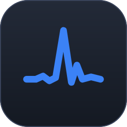

# Storm Machine

Настольная станция тестирования и диагностики сетей под Windows — один инструмент вместо
россыпи утилит, с памятью, расписанием и отчётностью.

> **Статус: готовится первый публичный выпуск.** Все три уровня возможностей собраны
> и проверены на стенде; на очереди боевые тесты на настоящем оборудовании.
> English: [README.md](README.md)

**Бесплатный и открытый.** Лицензия MIT, без платных редакций, ключей и учётных записей.

## Скачать и запустить

Storm Machine поставляется **только переносимым архивом** — установщика нет.

1. Скачайте `StormMachine-<версия>-win-x64-portable.zip` со страницы
   [Releases](https://github.com/voidnery/storm_machine/releases) и сверьте его
   с `SHA256SUMS.txt` (в PowerShell — `Get-FileHash <файл> -Algorithm SHA256`).
2. Распакуйте куда угодно, хоть на флешку, и запустите `StormMachine.exe`.
   `storm.exe` — тот же продукт консолью; `storm-agent.exe` и `storm-agent-ui.exe` —
   вторая точка измерения.
3. Захват кадров (соседи, посторонний DHCP) требует прав администратора.

Файл `storm.portable` рядом с программой держит базу измерений, настройки и журнал в той
же папке — на машине ничего не остаётся. Удалите его, и данные лягут
в `%LOCALAPPDATA%\StormMachine`.

**Обновление.** «Настройки → О продукте → Проверить» скажет, вышла ли новая версия,
и даст ссылку на неё. Без нажатия продукт к GitHub не обращается и сам себя не заменяет.
Новый архив распаковывают поверх старой папки — данные остаются.

**Вторая точка на Linux или macOS.** В каждом выпуске агент лежит и отдельно:
`storm-agent-<версия>-<платформа>.zip` для `win-x64`, `linux-x64`, `linux-arm64`,
`osx-x64`, `osx-arm64`.

Сборки пока не подписаны (заявка в SignPath Foundation на рассмотрении), и при первом
запуске SmartScreen предупредит: «Подробнее» → «Выполнить в любом случае». Сначала сверьте
контрольную сумму.

## Что это

Storm Machine заменяет привычный набор `ping`, `tracert`, `nmap`, `iperf3`, `mtr`,
спидтестов и SNMP-браузеров связной системой. Отличие от набора утилит — три сквозные
способности:

- **Память** — любое измерение попадает во временной ряд. «Сеть тормозит» превращается
  в график с baseline.
- **Повторяемость** — любой тест сохраняется как пресет и ставится на расписание.
- **Артефакт** — набор результатов превращается в PDF-отчёт со ссылкой на методику
  измерения (RFC 3550, RFC 6349, ITU-T G.107), который можно предъявить провайдеру.

## Планируемые возможности

**Локальная сеть** — мониторинг доступности и латентности, джиттер по RFC 3550 и PDV,
качество VoIP (MOS/R-фактор), оценка bufferbloat, скорость между точками, определение
PMTU, инвентаризация с распознаванием вендора по MAC и построение топологии из
взвешенных свидетельств, где ручные правки переживают повторные сканирования.

**Внешняя сеть** — конструктор probe-сценариев поверх ICMP/TCP/UDP/HTTP/DNS/TLS,
непрерывный MTR с потерями по хопам и аннотацией ASN, разбивка таймингов HTTP,
сравнение DNS-резолверов, инспектор TLS, определение типа NAT, готовность к IPv6,
SLA-мониторинг.

**Сквозное** — библиотека пресетов, расписание с окнами обслуживания, алерты,
PDF-отчёты со сравнением с эталоном.

## Уровни функциональности

Продукт деградирует честно, а не требует всего сразу:

| Уровень | Требует | Даёт |
|---------|---------|------|
| **0 — Ядро** | Ничего. Ни прав администратора, ни драйверов | ~80% ценности: пробы, мониторинг, traceroute, инвентаризация с MAC-адресами, топология L3, пресеты, расписание, отчёты |
| **1 — SNMP** | Учётные данные оборудования | Точная топология L2, привязка к портам свитчей, счётчики ошибок интерфейсов. **Сделано в И-17** |
| **2 — Захват** | Права администратора | Кадры LLDP/CDP, свой порт на коммутаторе, обнаружение постороннего DHCP. **Сделано в И-18 и И-25** |

Захват слушает встроенным в Windows `pktmon` (с версии 10 1809), ставить драйвер не нужно.
Npcap предпочтительнее, если пользователь поставил его сам, но **никогда не
распространяется вместе с продуктом** — это запрещено его лицензией.

**База вендоров по MAC** (реестр IEEE, 53 тысячи записей) **входит в поставку**: её
распространение не ограничено, а определение производителя устройства нужно сразу
после запуска и без интернета. Обновляется скриптом `tools/update-oui.cmd`.

**Данные о принадлежности адресов** — номера автономных систем в трассировке — берутся
из офлайн-базы [DB-IP Lite](https://db-ip.com/db/lite.php). Её лицензия CC BY-SA 4.0
требует, чтобы производные наследовали ту же лицензию, а это несовместимо с MIT нашего
кода, — поэтому в поставку база не входит. Скачайте `dbip-asn-lite` (и при желании
`dbip-country-lite`) в формате `.mmdb` и положите в папку `geo` каталога данных — рядом
со `StormMachine.exe` в переносимой копии, `%LOCALAPPDATA%\StormMachine\geo` без маркера;
переименовывать не нужно, файлы находятся по маске. Без базы трассировка работает
и показывает имена узлов из обратной зоны DNS.

## Технологии

.NET 10 · Avalonia 12 · ScottPlot · QuestPDF · MSAGL · SQLite

Quartz.NET значился здесь до И-14 и был отвергнут по итогам проверки: под обрезкой
публикации он падает молча. Планировщик написан свой — [R-15](docs/02-research.md).
Velopack ту же проверку прошёл — [R-19](docs/02-research.md) — и ушёл вместе
с установщиком, когда продукт перешёл на поставку только переносимым архивом.

Обоснование — в [ADR-0001](docs/adr/ADR-0001-technology-stack.md).

## Проектные документы

| Документ | Содержание |
|----------|-----------|
| [01-analysis.md](docs/01-analysis.md) | Требования, доменная модель, архитектурные принципы, карта UX |
| [02-research.md](docs/02-research.md) | Эмпирические результаты, разбор лицензий, конкуренты |
| [03-development-plan.md](docs/03-development-plan.md) | Цепочка итераций с критериями приёмки |
| [STATUS.md](docs/STATUS.md) | Где проект находится прямо сейчас |
| [RELEASES.md](docs/RELEASES.md) | Что в каждом выпуске, что проверено и что нет |
| [STATE.md](docs/STATE.md) | Что продукт держит на диске и где |
| [FIELD-TESTS.md](docs/FIELD-TESTS.md) | Чек-лист боевых тестов на настоящем оборудовании |
| [ARCHITECTURE.md](docs/ARCHITECTURE.md) | Карта кода и границы |
| [GITHUB-SETUP.md](docs/GITHUB-SETUP.md) | Репозиторий, подпись и порядок релизов |
| [SIGNPATH.md](docs/SIGNPATH.md) | Заявка в SignPath Foundation: что готово, что делать руками |

В каталоге [`spikes/`](spikes) лежат исследовательские программы, давшие цифры
из документа исследования — они воспроизводимы.

## Этика

Функции обнаружения предназначены для сетей, которыми вы владеете или которые
администрируете. Приложение подтверждает диапазоны сканирования, ограничивает темп
по умолчанию, ведёт журнал активных действий и не содержит средств эксплуатации уязвимостей.

## Лицензия

[MIT](LICENSE). Данные ASN и геолокации — [DB-IP](https://db-ip.com), CC BY-SA 4.0.
